# 💈 Barbearia Marquinhos

**Sistema completo de agendamento online e gestão para uma barbearia real, com mais de 5 anos de mercado.**
Site público para o cliente agendar em menos de um minuto + painel administrativo para a equipe operar o dia a dia.


> Projeto desenvolvido do zero, de ponta a ponta, por uma única pessoa: discovery com o cliente, arquitetura, design de UI/UX, front-end e back-end.
> **v1 em 1 mês**, **v2 em 15 dias** (correções e escalabilidade). Em produção e em uso diário há 3 meses.

---

## Sumário

- [Sobre o projeto](#sobre-o-projeto)
- [Telas](#telas)
- [Funcionalidades](#funcionalidades)
- [Stack](#stack)
- [Estrutura do repositório](#estrutura-do-repositório)
- [API](#api)
- [Como rodar localmente](#como-rodar-localmente)
- [Decisões de produto e desafios](#decisões-de-produto-e-desafios)
- [Autora](#autora)

---

## Sobre o projeto

A Barbearia Marquinhos controlava agenda, clientes e mensalistas de forma manual. O objetivo foi criar um produto que funcionasse no ritmo do balcão, sem atrapalhar quem está atendendo, e que ao mesmo tempo oferecesse ao cliente final uma experiência simples de agendamento.

O sistema tem duas frentes, em uma única aplicação React:

| Frente | Rota | Para quem |
| --- | --- | --- |
| **Site público** | `/` | Cliente final: conhece a barbearia, vê preços e agenda o horário |
| **Painel administrativo** | `/admin` | Barbeiros e dono: agenda, clientes, mensalistas, caixa e relatórios |

---

## Telas

### Site público

<p align="center">
  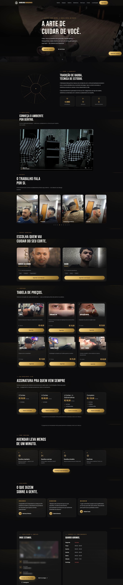
</p>

Hero, sobre a barbearia, tour pelo espaço (vídeo), galeria de trabalhos, barbeiros, tabela de preços, clube de mensalistas, como funciona o agendamento, avaliações e localização.

### Painel administrativo

<table>
  <tr>
    <td width="50%">
      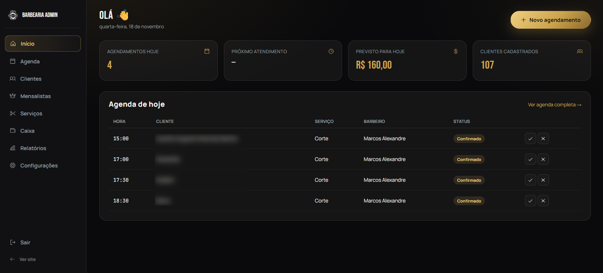
      <br><sub><b>Início</b>: indicadores do dia e agenda de hoje.</sub>
    </td>
    <td width="50%">
      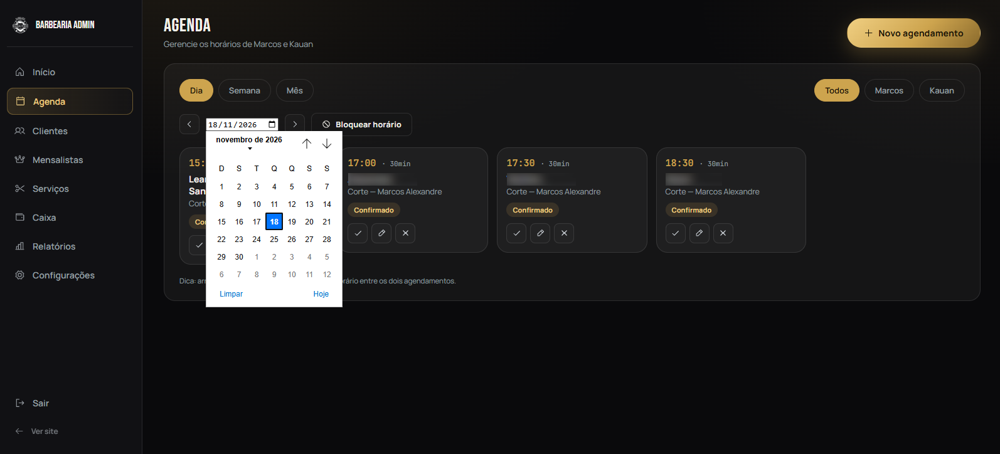
      <br><sub><b>Agenda</b>: visão por dia, semana e mês, com filtro por barbeiro.</sub>
    </td>
  </tr>
  <tr>
    <td width="50%">
      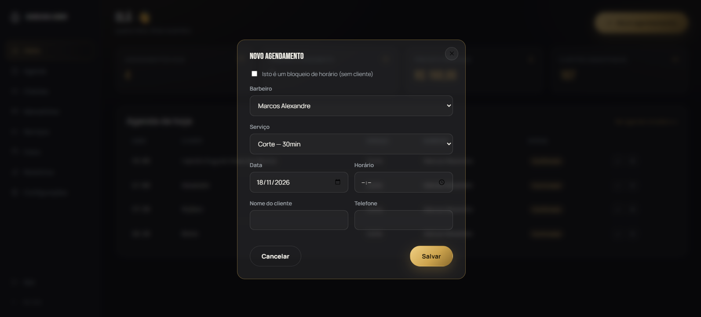
      <br><sub><b>Novo agendamento</b>: também permite bloquear horários.</sub>
    </td>
    <td width="50%">
      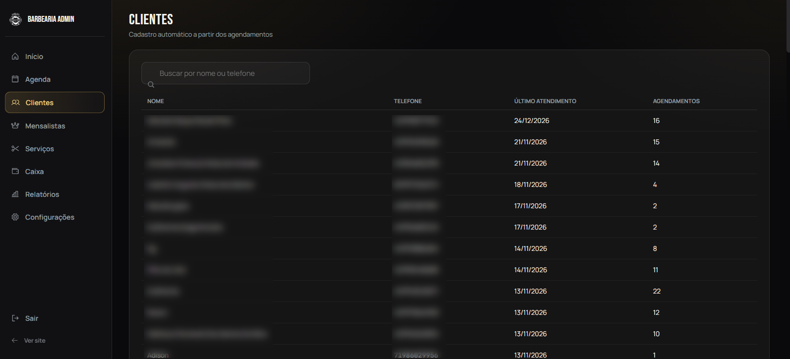
      <br><sub><b>Clientes</b>: cadastro automático a partir dos agendamentos.</sub>
    </td>
  </tr>
  <tr>
    <td width="50%">
      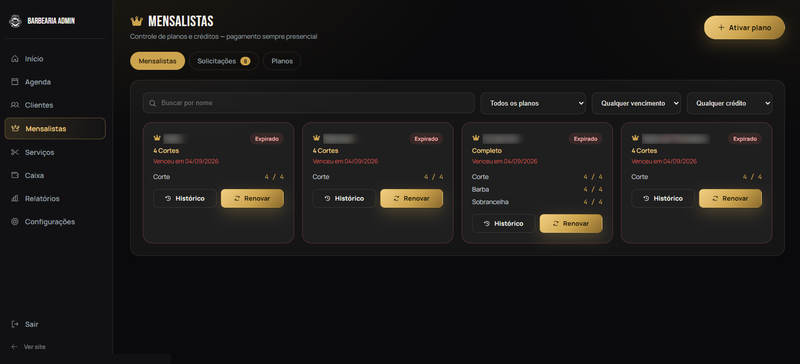
      <br><sub><b>Mensalistas</b>: planos, créditos por serviço, vencimento e renovação.</sub>
    </td>
    <td width="50%">
      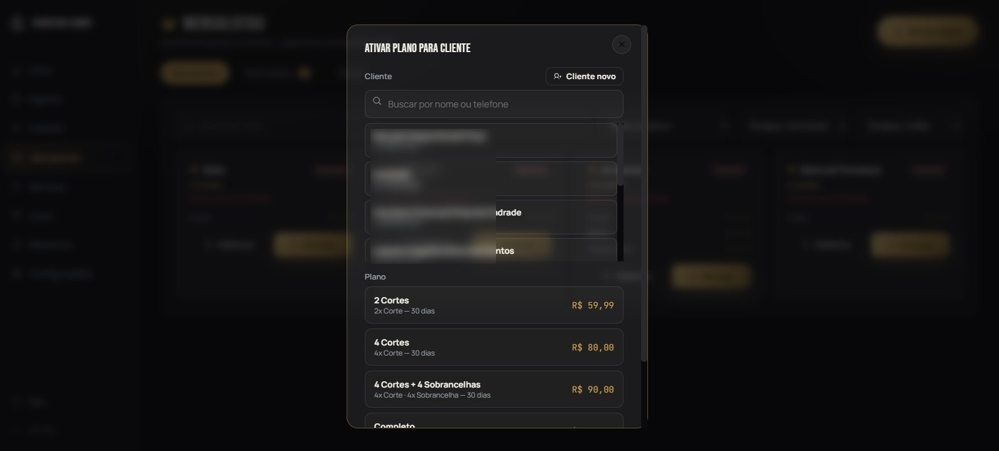
      <br><sub><b>Ativar plano</b>: para um cliente já cadastrado.</sub>
    </td>
  </tr>
  <tr>
    <td width="50%">
      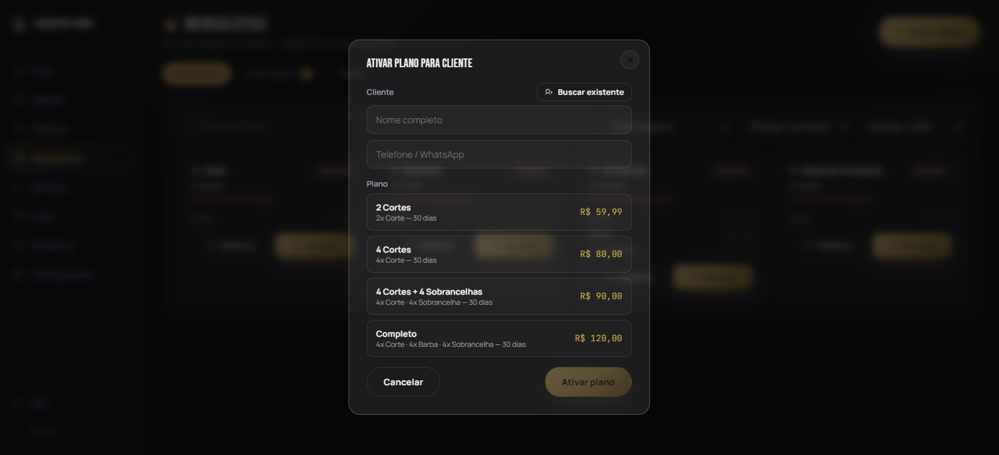
      <br><sub><b>Ativar plano</b>: cadastrando um cliente novo na hora.</sub>
    </td>
    <td width="50%">
      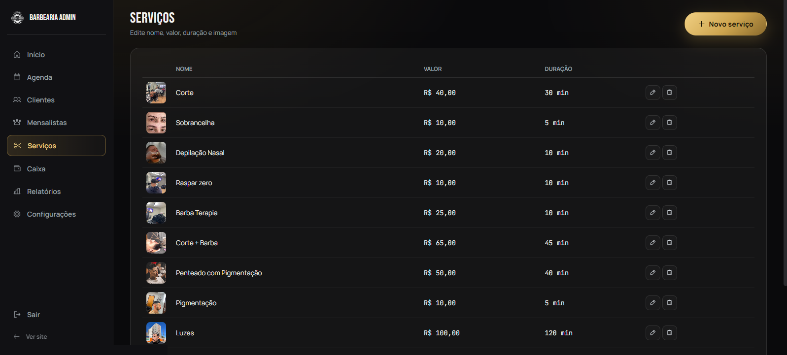
      <br><sub><b>Serviços</b>: nome, valor, duração e imagem.</sub>
    </td>
  </tr>
  <tr>
    <td width="50%">
      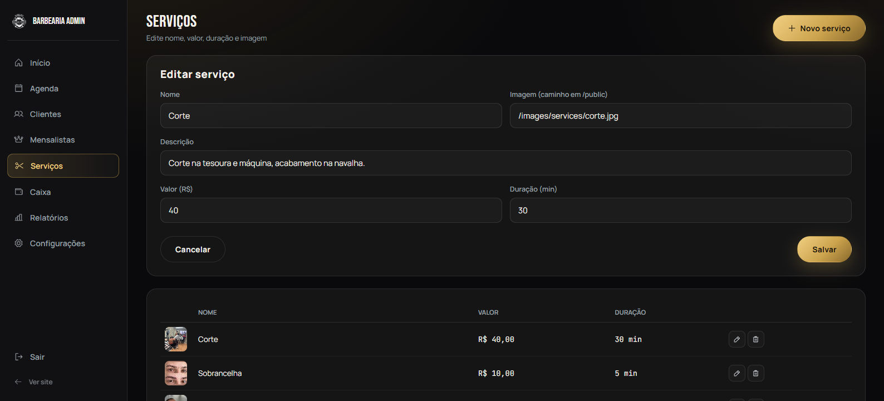
      <br><sub><b>Editar serviço</b>: formulário inline.</sub>
    </td>
    <td width="50%">
      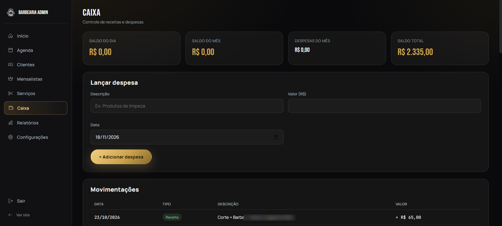
      <br><sub><b>Caixa</b>: saldos, lançamento de despesas e movimentações.</sub>
    </td>
  </tr>
  <tr>
    <td width="50%">
      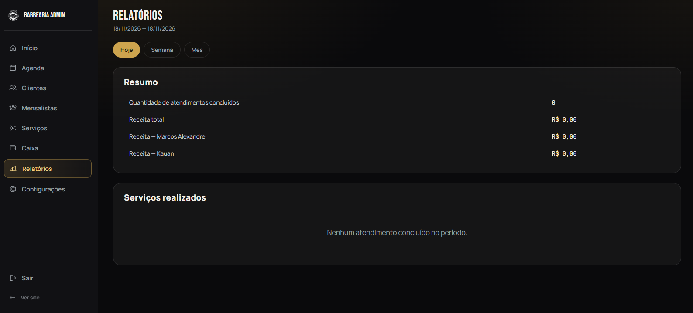
      <br><sub><b>Relatórios</b>: atendimentos e receita por período e por barbeiro.</sub>
    </td>
    <td width="50%">
      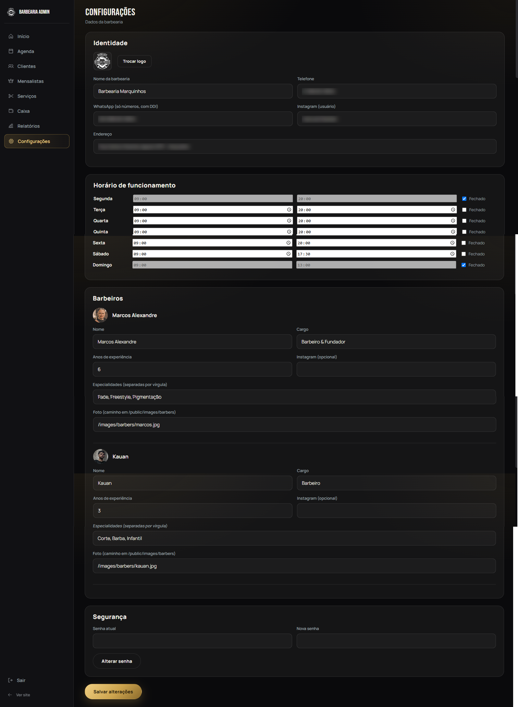
      <br><sub><b>Configurações</b>: identidade, horários, barbeiros e senha.</sub>
    </td>
  </tr>
</table>

> Dados de clientes foram desfocados nas capturas.

---

## Funcionalidades

### Site público
- Agendamento online em poucos passos: barbeiro, serviço, horário livre e confirmação com nome e telefone.
- Horários disponíveis calculados em tempo real, respeitando duração do serviço, bloqueios e horário de funcionamento.
- Tabela de preços com valor e duração de cada serviço.
- **Marquinhos Club**: apresentação dos planos mensais e solicitação de contratação (o pagamento é sempre presencial, na barbearia).
- Galeria de trabalhos (carrossel), apresentação dos barbeiros, avaliações, mapa, contato por WhatsApp e Instagram.

### Painel administrativo
- Login com autenticação JWT e troca de senha.
- **Início**: agendamentos do dia, próximo atendimento, previsão de receita e total de clientes.
- **Agenda**: visões de dia, semana e mês, filtro por barbeiro, bloqueio de horário, confirmar, concluir, editar e cancelar atendimentos.
- **Clientes**: cadastro automático a partir dos agendamentos, com busca por nome ou telefone, último atendimento e total de agendamentos.
- **Mensalistas**: planos com créditos por serviço, validade, renovação, histórico de consumo, alertas de vencimento e fila de solicitações vindas do site.
- **Serviços**: cadastro, edição e remoção, com imagem, valor e duração.
- **Caixa**: receitas geradas pelos atendimentos concluídos, lançamento de despesas e saldos do dia, do mês e total.
- **Relatórios**: atendimentos concluídos e receita por período (hoje, semana, mês) e por barbeiro.
- **Configurações**: identidade da barbearia, horário de funcionamento por dia, dados dos barbeiros e segurança.

---

## Stack

| Camada | Tecnologias |
| --- | --- |
| Front-end | React 19, Vite, React Router, Framer Motion, Swiper, Axios, Phosphor Icons |
| Back-end | Node.js, Express 5, API REST |
| Banco de dados | libSQL (compatível com SQLite, local ou remoto via Turso) |
| Autenticação | JWT (`jsonwebtoken`) e senhas com hash (`bcryptjs`) |
| Qualidade | oxlint |

---

## Estrutura do repositório

```text
.
├── backend/
│   └── src/
│       ├── index.js          # servidor Express e montagem das rotas
│       ├── db/               # conexão e schema.sql
│       ├── middleware/       # autenticação JWT
│       ├── models/           # acesso a dados (appointments, clients, plans, ...)
│       ├── routes/           # endpoints da API
│       └── utils/            # slots (horários livres), períodos, ids
└── frontend/
    ├── public/images/        # fotos de barbeiros, serviços e galeria (veja os LEIA-ME.txt)
    └── src/
        ├── components/       # seções do site e componentes do painel (admin/)
        ├── context/          # autenticação e dados do site
        ├── pages/            # Home, Login e páginas do painel (admin/)
        └── hooks/
```

---

## API

Todas as rotas ficam sob `/api`. As rotas administrativas exigem token JWT.

| Prefixo | Responsabilidade |
| --- | --- |
| `/api/auth` | Login e troca de senha |
| `/api/appointments` | Horários livres, criação, edição, conclusão e cancelamento de agendamentos |
| `/api/clients` | Listagem e cadastro de clientes |
| `/api/barbers` | Barbeiros |
| `/api/services` | Serviços |
| `/api/plans` | Planos de mensalistas (listagem pública e gestão) |
| `/api/client-plans` | Planos ativos dos clientes, renovação, histórico e alertas |
| `/api/plan-requests` | Solicitações de plano feitas pelo site |
| `/api/transactions` | Receitas e despesas do caixa |
| `/api/dashboard` | Dados da tela inicial, do caixa e dos relatórios |
| `/api/settings` | Configurações da barbearia |

---

## Como rodar localmente

**Pré-requisito:** Node.js 20 ou superior.

### 1. Back-end

```bash
cd backend
npm install
```

Crie um arquivo `.env` em `backend/` com:

```env
PORT=4000
JWT_SECRET=troque-por-um-segredo-forte

# Banco de dados: use um arquivo SQLite local...
DB_PATH=./data/barbearia.db

# ...ou um banco remoto (Turso)
# TURSO_DATABASE_URL=
# TURSO_AUTH_TOKEN=
```

```bash
npm run dev
```

### 2. Front-end

```bash
cd frontend
npm install
npm run dev
```

O site abre em `http://localhost:5173` e o Vite encaminha as chamadas de `/api` para `http://localhost:4000`. O painel fica em `/admin`.

### Scripts

| Local | Comando | O que faz |
| --- | --- | --- |
| `backend` | `npm run dev` | Servidor com recarga automática (nodemon) |
| `backend` | `npm start` | Servidor em modo produção |
| `frontend` | `npm run dev` | Servidor de desenvolvimento do Vite |
| `frontend` | `npm run build` | Build de produção |
| `frontend` | `npm run lint` | Análise estática com oxlint |

---

## Decisões de produto e desafios

- **Pagamento sempre presencial.** Por isso, o cliente que quer ser mensalista faz uma *solicitação* pelo site e o barbeiro aprova e ativa o plano no painel, sem integração com gateway.
- **Cadastro de clientes automático.** Ninguém precisa preencher ficha: o cliente é criado a partir do primeiro agendamento, o que economiza tempo no balcão.
- **A agenda foi o maior desafio.** Dois barbeiros, serviços com durações diferentes, bloqueios de horário, dias de folga e vários clientes disputando o mesmo horário exigiram um cálculo de horários livres cuidadoso (`backend/src/utils/slots.js`), inclusive com ajuste para o fuso de Brasília.
- **Ciclo em duas versões.** A v1 entregou o fluxo completo em cerca de 1 mês; a v2 (15 dias) focou em correções e escalabilidade a partir do uso real.

---

## Autora

Desenvolvido por **Mylena Luz**: discovery, arquitetura, UI/UX, front-end e back-end.

[](https://github.com/MylenaLuz)
